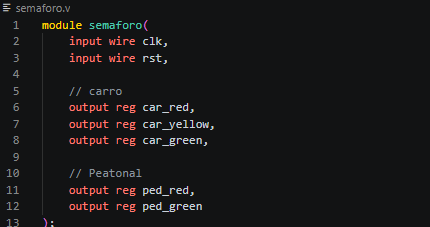
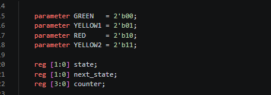
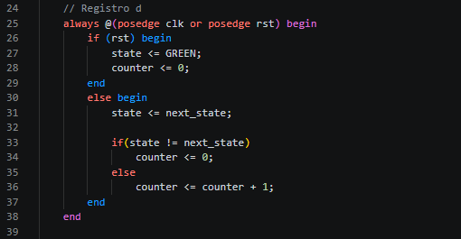
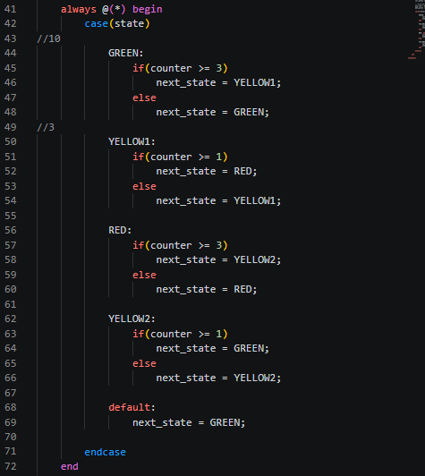
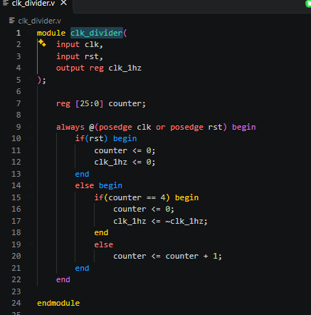
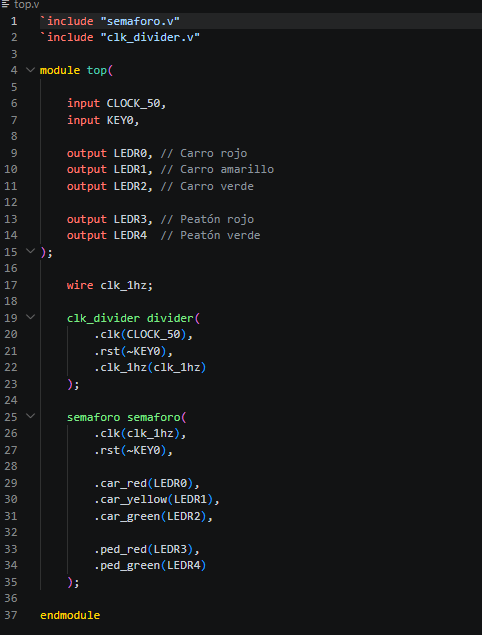
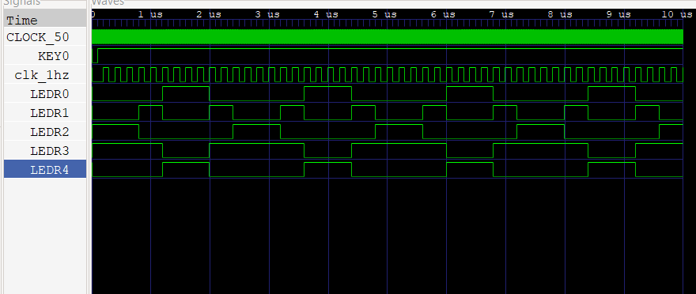

# Técnicas Digitales G3 E9

# Máquinas de Estado Finito: Semáforo Básico en FPGA

# Integrantes
* [Jefferson Stiven Quiñones Yate](https://github.com/jeffersonstquinonesya-bit) 
* [Oscar David Vargas ](https://github.com/oscardavargas) 

## Índice

- [1. Introducción](#1-introducción)
- [2. Objetivos](#2-objetivos)
- [3. Marco teórico](#3-marco-teórico)
- [4. Conclusiones](#4-conclusiones)

## 1. Introducción
El proyecto se compone de una máquina de estados encargada de gestionar las transiciones del semáforo, un divisor de reloj para adecuar la velocidad de funcionamiento a una frecuencia observable y un módulo principal que integra todos los componentes para su implementación en una FPGA.

El sistema diseñado simula el comportamiento básico de un semáforo real, garantizando la alternancia segura entre el paso de vehículos y peatones mediante una secuencia controlada de luces.

## 2. Objetivos

### 2.1 objetivo general.
Diseñar e implementar un sistema de control de semáforo vehicular y peatonal mediante una máquina de estados finitos utilizando Verilog HDL.

### 2.2 Objetivo especifico .

* Diseñar una máquina de estados finitos para controlar la secuencia de luces del semáforo.
* Implementar un divisor de frecuencia para generar una señal de reloj adecuada para la visualización de los cambios de estado.
* Utilizar registros y lógica secuencial para la gestión de estados y temporización.
* Verificar el funcionamiento del sistema en una FPGA mediante el uso de LEDs como indicadores visuales

## 3. Marco teórico.

### 3.1 Modulo Semaforo.
El módulo semaforo es el encargado de controlar las luces del semáforo vehicular y peatonal mediante una Máquina de Estados Finitos (FSM). Su función principal es determinar qué luces deben encenderse y cuándo debe realizarse la transición entre los diferentes estados.

`ENTRADAS Y SALIDAS `

* clk: señal de reloj que sincroniza el funcionamiento del sistema.
* rst: señal de reinicio que devuelve el sistema al estado inicial.

* car_red → luz roja.
* car_yellow → luz amarilla.
* car_green → luz verde.
* ped_red → peatones detenidos.
* ped_green → peatones pueden cruzar.

### `DEFINICION DE ESTADOS`

`Se definen cuatro estados posibles:`

GREEN -------Vehículos avanzan.

YELLOW1 ----- Cambio de verde a rojo.

RED	--------- -Vehículos detenidos, peatones avanzan.

YELLOW2 ---- Cambio de rojo a verde.

### `VARIABLES DE CONTROL`

`state :`
 Almacena el estado actual.

`next_state :`
Guarda el siguiente estado calculado por la FSM.

`counter :`
Cuenta el tiempo que permanece el sistema en cada estado.

### `Registro de estado.`

* el bloque `always` se ejecuta en cada flanco positivo del reloj y cuando se activa el reset.
* cuando se preciona el boton reset el semaforo comienza en verde y el contador vuelve a cero. 
* `state <= next_state; :` Actualiza el estado actual con el próximo estado calculado. 

### `Lógica de transición`

este bloque calcula cual sera la siguiente trasicion de ls semaforos.

`ESTADO GREEN: ` el contador permanece en verde mientras que el contador permanezaca en 3.
`ESTADO YELLOW1: `Permanece un tiempo corto antes de pasar a rojo.
`ESTADO RED: ` Los vehículos permanecen detenidos mientras los peatones pueden cruzar
`ESTADO YELLOW2: ` Prepara el regreso al estado verde.

### 3.2 Modulo clk_divider.

El módulo clk_divider se encarga de reducir la frecuencia del reloj principal de la FPGA para que los cambios de estado del semáforo ocurran lentamente y puedan observarse en los LEDs.

### `Resultado`

* El módulo genera una señal de reloj más lenta a partir del reloj principal, permitiendo que la máquina de estados del semáforo cambie de estado a una velocidad visible.
* actúa como un temporizador que cuenta pulsos del reloj original y genera una señal más lenta para controlar la velocidad de funcionamiento del semáforo.

### 3.3 Modulo Top.

Su función es conectar el divisor de reloj (clk_divider) con la máquina de estados (semaforo) y asignar las señales a los LEDs de la FPGA.

`wire clk_1hz;`: Se declara una señal interna llamada clk_1hz, que transporta el reloj dividido desde el módulo clk_divider hasta el módulo semaforo. 

`clk_divider divider:`

Este bloque crea una instancia del módulo clk_divide la  función que cumple es 

* Recibir el reloj de 50 MHz.
* Reducir su frecuencia.
* Generar la señal clk_1hz.

`instancia semaforo semaforo` 
Aquí se crea una instancia del módulo semaforo es el que  recibe:

* El reloj dividido (clk_1hz).
* La señal de reset.
* envía directamente sus salidas a los LEDs de la placa.

### `simulacion verilog`

## 4. conclusiones.

* Se implementó satisfactoriamente una máquina de estados finitos para controlar un sistema de semáforo vehicular y peatonal.

* El uso de Verilog HDL permitió desarrollar una solución modular basada en distintos componentes reutilizables.
* El divisor de reloj hizo posible observar claramente las transiciones entre estados en la FPGA.

* El sistema cumple con la secuencia de operación esperada, garantizando la alternancia entre el tráfico vehicular y peatonal de forma ordenada y segura.
* La práctica permitió afianzar conocimientos sobre diseño de hardware programable y descripción de sistemas digitales utilizando Verilog.