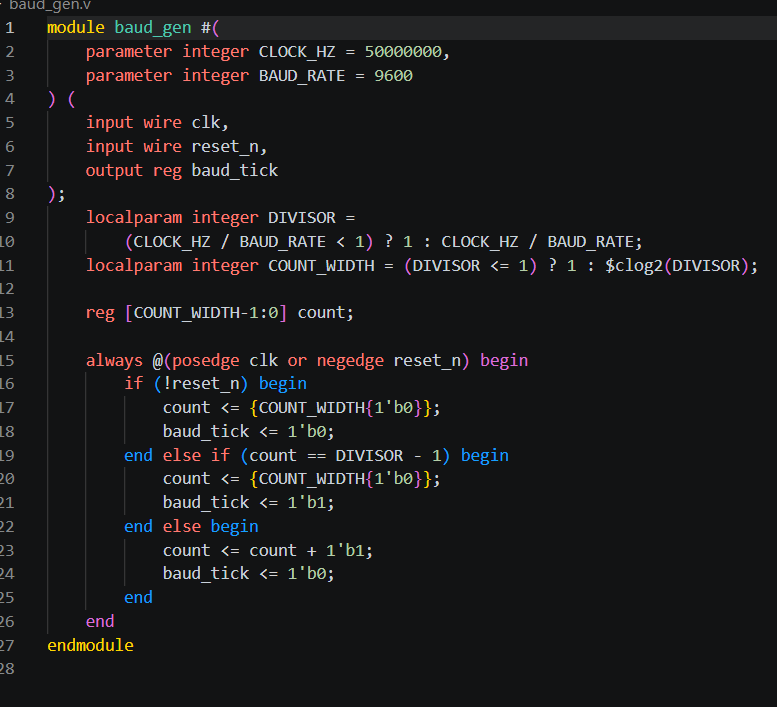
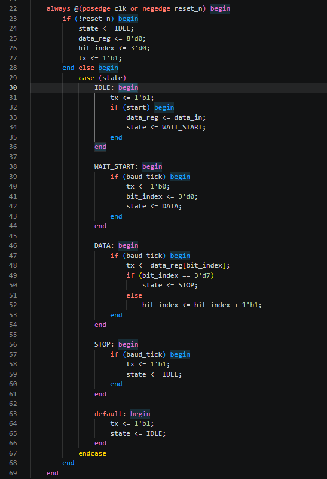
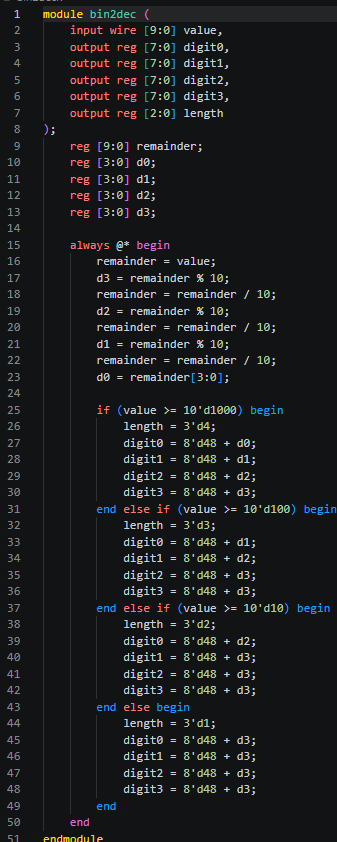
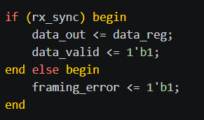

# Técnicas Digitales G3 E9

# Máquinas de Estado Finito: Semáforo Básico en FPGA

# Integrantes
* [Jefferson Stiven Quiñones Yate](https://github.com/jeffersonstquinonesya-bit) 
* [Oscar David Vargas ](https://github.com/oscardavargas) 

## Índice

- [1. Introducción](#1-introducción)
- [2. Objetivos](#2-objetivos)
- [3. Marco teórico](#3-marco-teórico)
- [4. Conclusiones](#4-conclusiones)
- [5. preguntas de analisis](#4-conclusiones)

## 1. Introducción
Este proyecto implementa un sistema de comunicación UART (Universal Asynchronous Receiver Transmitter) en Verilog. El diseño permite transmitir y recibir caracteres ASCII a través de una interfaz serie, convertir datos numéricos a formato decimal para visualización y procesar cadenas recibidas para obtener valores numéricos.

La arquitectura está dividida en varios módulos independientes, cada uno con una función específica. Esta modularidad facilita el mantenimiento, la reutilización de código y la depuración del sistema.

## 2. Objetivos

### 2.1 objetivo general.
Diseñar e implementar un sistema UART completo en Verilog capaz de transmitir, recibir y procesar datos seriales.

### 2.2 Objetivo especifico.

* Generar la señal de temporización UART mediante un divisor de frecuencia.
* Implementar un transmisor UART capaz de enviar datos serie.
Implementar un receptor UART capaz de reconstruir datos recibidos.
* Convertir números binarios a decimal para visualización.
* Convertir caracteres ASCII recibidos a valores numéricos.
Integrar todos los módulos en un sistema funcional.
* Verificar el correcto funcionamiento mediante simulación.

## 3. Marco teórico.

### 3.1 Módulo baud_gen.
Su función consiste en transformar el reloj principal de la FPGA (50 MHz) en pulsos mucho más lentos, equivalentes a la velocidad de transmisión configurada (9600 baudios).

.

El reloj de la FPGA funciona a:
`50 MHz = 50.000.000` ciclos por segundo.
El reloj de la UART funciona a:
`9600 bits` por segundo.

Por tanto, es necesario dividir la frecuencia original para obtener eventos sincronizados cada tiempo de bit.

`reg [COUNT_WIDTH-1:0] count;`

Esta variable funciona como un cronómetro.

### 3.2 Módulo uart_tx.v

Transmite un dato de 8 bits mediante el protocolo UART.

`Funcionamiento`

Cuando recibe una orden de inicio, almacena el dato en un registro interno y genera la trama UART compuesta por:

* Bit de inicio (Start).
+ 8 bits de datos.
* Bit de parada (Stop).

La transmisión se realiza un bit por cada pulso de baud_tick.

 `Código importante`

* `tx <= data_reg[bit_index];`

Envía cada bit del dato almacenado hacia la línea de transmisión.

### 3.3 Módulo uart_rx.v

Recibe los datos enviados mediante UART y reconstruye el byte original.

`Funcionamiento`

El módulo detecta el bit de inicio, lee los 8 bits de datos utilizando la señal baud_tick y verifica el bit de parada. Si la recepción es correcta, activa la señal data_valid.

 `Código importante`

* `data_reg[bit_index] <= rx_sync;`

Almacena cada bit recibido dentro del registro de datos.

### 3.4 Módulo bin2dec.v

Convierte un valor binario a sus correspondientes dígitos ASCII.

`Funcionamiento`

El módulo separa el número en centenas, decenas y unidades mediante divisiones enteras y posteriormente convierte cada dígito a código ASCII sumando el valor correspondiente al carácter '0'.

 `Código importante`

* `digit0 = 8'd48 + d0;`
Convierte un dígito numérico al carácter ASCII correspondiente.

### 3.5 Módulo dec2bin.v

Convierte una secuencia de caracteres ASCII recibidos por UART en un valor numérico binario.

`Funcionamiento`

Cada vez que recibe un carácter numérico, actualiza un acumulador utilizando la operación:

`nuevo_valor = valor_actual × 10 + dígito`

Cuando recibe la tecla Enter, el número queda disponible mediante la señal value_valid.

`Código importante`

* `next_value = (accumulator * 10) + (data_in - 8'h30);`

Realiza la conversión de caracteres ASCII a un número decimal.

### 3.6 Módulo proyecto_uart.v

Integra todos los módulos del sistema UART.

`Funcionamiento`

Coordina la comunicación entre el transmisor, el receptor y los módulos de conversión. Los datos recibidos son convertidos de ASCII a número, mostrados en los LEDs y posteriormente convertidos nuevamente a ASCII para su transmisión.

 `Código importante`

* `assign LEDR = received_value;`

Muestra en los LEDs el valor procesado por el sistema.

`Importancia del módulo`

Este módulo no realiza cálculos complejos, pero coordina toda la comunicación entre los diferentes bloques. Sin él, los módulos funcionarían de forma aislada y no podrían intercambiar información.

### 3.7 Testbench tb_proyecto_uart.v

Verifica el funcionamiento del diseño mediante simulación.

`Funcionamiento`

Genera señales de reloj, simula la recepción de datos UART y comprueba automáticamente que las respuestas transmitidas sean correctas.

`Código importante`

* `$fatal(...)`

Detiene la simulación cuando se detecta un resultado incorrecto.
## 5. Resultados

Los resultados obtenidos evidencian que el sistema UART implementado cumple satisfactoriamente los objetivos planteados. La integración de los módulos baud_gen, uart_tx, uart_rx, bin2dec y dec2bin permitió establecer una comunicación serial funcional, capaz de recibir caracteres ASCII, procesarlos internamente como valores numéricos y retransmitirlos correctamente.

Además, las pruebas realizadas demuestran que el diseño es capaz de manejar números de uno, dos y tres dígitos sin errores, validando el correcto funcionamiento de las máquinas de estados, los algoritmos de conversión y la sincronización temporal de la comunicación UART.

## 4. conclusiones.

1. El módulo baud_gen proporciona la temporización fundamental que sincroniza toda la comunicación UART.

2. El módulo uart_tx implementa una máquina de estados eficiente para transmitir bytes de forma serial siguiendo el protocolo UART.

3. El módulo uart_rx permite recuperar correctamente los datos transmitidos y detectar errores mediante la verificación del bit de parada.

4. El módulo bin2dec convierte valores binarios a caracteres ASCII, facilitando la visualización de los datos transmitidos.

5. El módulo dec2bin constituye uno de los módulos más importantes del proyecto, ya que transforma cadenas ASCII recibidas en valores numéricos mediante el uso de un acumulador decimal.

6. El módulo proyecto_uart integra todos los bloques funcionales en una arquitectura coherente, permitiendo la comunicación completa entre transmisión, recepción y procesamiento de datos.

7. El testbench demuestra mediante simulación que el sistema funciona correctamente para distintos valores de entrada, validando el diseño antes de su implementación física en FPGA.

## 5. preguntas de analisis.

1. `¿Por qué un byte UART no alcanza para representar los números de 0 a 1023 y cómo lo resuelve el diseño?`

Un byte tiene 8 bits, por lo que puede representar (2^8 = 256) valores: de 0 a 255. Para representar directamente hasta 1023 se necesitan 10 bits, porque (2^{10} = 1024).

UART transmite bytes de 8 bits. Este diseño resuelve la diferencia convirtiendo el número a texto decimal y enviando un byte ASCII por cada dígito. Por ejemplo, 677 se envía como los caracteres "6", "7" y "7". Al recibirlos, el módulo decimal los reconstruye como un único número.

Así, no se intenta enviar 677 en un solo byte: se envía como varios bytes UART. El diseño también puede transmitir los terminadores CR y LF para indicar el final de la línea.

3. `¿Por qué el receptor es más complejo que el transmisor?`

El transmisor sabe cuándo comienza cada bit: el reloj interno y baud_tick le indican cuándo cambiar la salida. Su trabajo es presentar, en orden, el bit de inicio, los ocho datos y el bit de parada.

El receptor no controla cuándo cambia la señal externa. Debe detectar el bit de inicio, sincronizar la entrada, estimar cuándo muestrear cada bit y comprobar que la trama terminó correctamente. Por eso tiene que manejar más casos, como un inicio falso o un bit de parada incorrecto.

En el proyecto, uart_tx avanza por estados para enviar cada bit, mientras que uart_rx detecta el inicio, espera al centro de los bits y valida la parada.

4. `¿Por qué se detecta el flanco del botón y no su nivel para transmitir?`

El botón KEY0 es activo en bajo. El diseño detecta la transición de no presionado a presionado con:
`key_previous && !key_sync`

La condición significa que antes la señal estaba alta y ahora está baja: se produjo un flanco descendente.

Si se usara solo el nivel bajo, mientras el usuario mantuviera presionado el botón podría solicitarse una transmisión cada vez que el sistema volviera a estar disponible. Detectar el flanco genera una única solicitud al momento de presionarlo, aunque se mantenga apretado.

5. `¿Qué es un error de trama (framing error) y cómo lo detectaría el receptor?`

Una trama UART normal tiene un bit de inicio bajo (0), ocho bits de datos y un bit de parada alto (1). Hay un error de trama cuando el receptor espera el bit de parada, pero encuentra un 0.

El módulo uart_rx revisa el nivel en el estado STOP:

Si la línea está alta, acepta el byte y activa data_valid. Si está baja, no marca el byte como válido y activa framing_error.

6. `¿Por qué es necesario sincronizar la línea RX antes de usarla en la máquina de estados?`

RX llega desde otro dispositivo y puede cambiar en cualquier momento respecto al reloj de la FPGA. Si cambia cerca del flanco de reloj, los registros internos podrían entrar brevemente en un estado inestable, conocido como metastabilidad.

El diseño pasa la entrada por dos registros:

`rx_meta <= rx;`

`rx_sync <= rx_meta;`

La máquina de estados utiliza rx_sync, que ya ha pasado por esas etapas de sincronización. Esto reduce la probabilidad de que la metastabilidad afecte al resto del circuito; no elimina por completo el riesgo, pero es una práctica habitual para señales asíncronas.

7. `¿Qué diferencia habría entre enviar el número en binario crudo y enviarlo como texto ASCII?`

Como texto ASCII, cada dígito se transmite como un byte. Por ejemplo, 677 requiere tres bytes para los dígitos, y en este diseño se agregan CR y LF. Es más fácil de leer y depurar con una terminal serial, pero utiliza más bytes y requiere convertir entre texto y número.

En binario crudo, el valor se enviaría directamente como bits. Para cubrir de 0 a 1023 hacen falta 10 bits; como UART transmite bytes de 8 bits, normalmente se necesitarían dos bytes para empaquetarlo. Es más compacto para un valor como 677, pero ambos extremos deben acordar cómo se distribuyen esos 10 bits y cómo se identifica dónde termina el número. También es menos legible en una terminal.